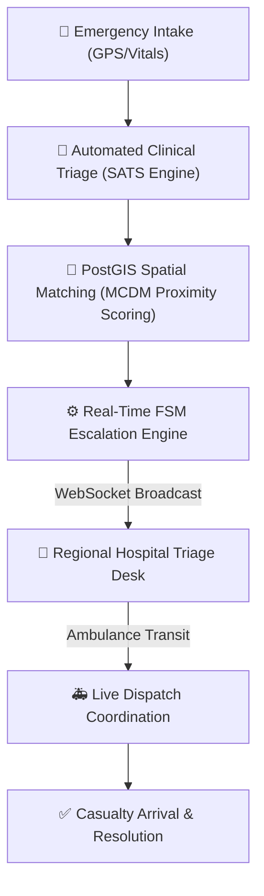

# 🏥 MedLink

**Intelligent Computer-Aided Dispatch (CAD) & Regional Healthcare Coordination Platform**

[](LICENSE)
[](https://nodejs.org/)
[](https://postgis.net/)
[](https://react.dev/)
[](https://vitejs.dev/)
[](https://socket.io/)

MedLink is an enterprise-grade Computer-Aided Dispatch (CAD) and regional healthcare coordination platform designed for emergency casualty triage, geospatial hospital ranking using PostGIS, real-time WebSocket hospital telemetry, and resilient offline-first casualty intake.

---

## 📌 Architecture & Core Capabilities



### Key Modules
- **Automated Clinical Triage (SATS)**: Multi-parameter vital assessment (SpO2, heart rate, systolic blood pressure, AVPU consciousness level) with automated clinical acuity classification.
- **PostGIS Geospatial Matching**: Microsecond-latency spatial queries (`ST_SetSRID(ST_MakePoint(...), 4326)`) combined with Multi-Criteria Decision Making (MCDM) weighing distance, ICU bed saturation, doctor availability, and blood bank stock.
- **Finite State Machine (FSM) Escalation Engine**: Automated escalation pipeline (`reported` ➔ `assessing` ➔ `requested` ➔ `assigned` ➔ `en_route` ➔ `arrived` ➔ `resolved`) with timeout fallbacks to secondary regional facilities.
- **Real-Time Telemetry & WebSockets**: Dedicated Socket.IO streaming rooms for instantaneous dispatch alerts, status synchronization, and hospital inventory tracking.
- **Role-Based Access Control (RBAC)**: Enforces strict isolation across CAD Dispatchers, Hospital Facility Managers, and Citizen Portals.
- **Offline-First Resilience**: Local storage outbox queuing with bi-directional delta synchronization (`/api/sync/delta`) when network connectivity is restored.

---

## 📂 Project Structure

```
├── backend/                  # Express REST API & Socket.IO real-time engine
│   ├── db/                   # Database schemas & spatial indexes
│   ├── scripts/              # Database initialization, migration & seed scripts
│   ├── src/
│   │   ├── config/           # Database pool configuration
│   │   ├── middleware/       # JWT authentication & RBAC authorization
│   │   ├── routes/           # REST endpoints (auth, incidents, hospitals, analytics, sync)
│   │   ├── services/         # Clinical triage, PostGIS matcher, FSM coordinator
│   │   └── server.js         # HTTP & WebSocket entrypoint
│   └── package.json
│
├── frontend/                 # React 19 + Vite CAD Web Application
│   ├── src/
│   │   ├── components/       # Glassmorphism dispatch dashboards, explorers & intake forms
│   │   ├── context/          # Authentication & session context
│   │   ├── utils/            # Offline outbox & local storage caching
│   │   ├── api.js            # Centralized REST API client
│   │   └── socket.js         # Socket.IO client
│   └── package.json
│
└── README.md
```

---

## 🚀 Quick Start

### Prerequisites
- **Node.js** (v18.0.0 or higher)
- **PostgreSQL 14+** with the **PostGIS extension** enabled
- **npm** or **yarn**

### 1. Backend Setup

```bash
cd backend
npm install
cp .env.example .env
# Configure your PostgreSQL credentials in .env
```

**Initialize Database:**
```bash
npm run db:setup
```

**Start Backend Server:**
```bash
npm run dev
# Server running at http://localhost:4000 (WebSocket on ws://localhost:4000)
```

### 2. Frontend Setup

```bash
cd frontend
npm install
npm run dev
# Application available at http://localhost:5173
```

---

## 📄 License
This project is licensed under the MIT License - see the [LICENSE](LICENSE) file for details.
Commit at 2026-08-30T04:07:33.612946
Commit at 2025-11-04T06:56:56.850678
Commit at 2025-11-19T14:28:16.022499
Commit at 2026-03-03T23:17:30.202415
Commit at 2025-11-11T03:01:55.377026
Commit at 2025-12-02T21:18:33.558406
Commit at 2026-08-28T22:11:47.746479
Commit at 2026-02-07T09:44:59.939501
