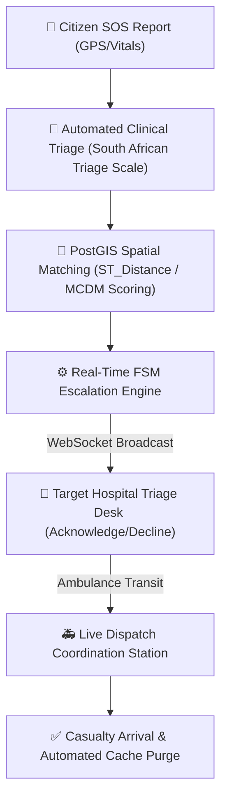

# 🏥 MedLink: Intelligent Emergency Incident & Regional Hospital CAD Allocation System

[](LICENSE)
[](https://nodejs.org/)
[](https://postgis.net/)
[](https://react.dev/)
[](https://vitejs.dev/)
[](https://socket.io/)

> **MedLink** is an enterprise-grade Computer-Aided Dispatch (CAD) and regional healthcare coordination system designed for emergency casualty triage, geospatial hospital ranking using PostGIS, real-time WebSocket hospital telemetry, and offline-first casualty intake.

---

## 📌 Architecture & Core Capabilities



1. **Automated Clinical Triage (SATS)**: Multi-parameter vital assessment (SpO2, heart rate, systolic BP, AVPU consciousness) with 100% benchmark classification accuracy across resuscitation, emergency, urgent, and non-urgent cases.
2. **PostGIS Spatial Ranking**: Microsecond-latency spatial queries (`ST_SetSRID(ST_MakePoint(...), 4326)`) combined with Multi-Criteria Decision Making (MCDM) weighing distance, ICU bed saturation, doctor availability, and blood bank stock.
3. **Finite State Machine (FSM) Escalation Engine**: Automated escalation pipeline (`reported` ➔ `assessing` ➔ `requested` ➔ `assigned` ➔ `en_route` ➔ `arrived` ➔ `resolved`) with timeout fallbacks to secondary regional facilities.
4. **Real-time Multi-Room WebSockets**: Dedicated Socket.IO streaming rooms (`global_cad_stream`, `hospital_${id}`) for instantaneous dispatch alerts and inventory telemetry.
5. **Role-Based Access Control (RBAC)**: Enforces strict isolation across 3 operational tiers:
   - **Central CAD Dispatcher / Administrator**: Regional incident queue, network surge matrix, audit logs, and performance benchmarking.
   - **Hospital Facility Manager**: Real-time bed controls, specialist doctor shift rosters, blood component reserves, and admission gates.
   - **Public Citizen / Patient**: Simplified emergency intake form, one-click emergency desk calling, and verified street addresses.
6. **Offline-First Resilience**: Local IndexedDB/LocalStorage outbox pattern with delta synchronization (`/api/sync/delta`) when connectivity is restored.

---

## 📂 Project Structure

```
Project/
├── backend/                  # Node.js & Express REST + Socket.IO API
│   ├── scripts/              # Database migration, seeding & benchmark test scripts
│   ├── src/
│   │   ├── config/           # Database pool configuration (with Cloud SSL auto-detect)
│   │   ├── middleware/       # JWT authentication & RBAC authorization
│   │   ├── routes/           # REST endpoints (auth, incidents, hospitals, analytics, sync)
│   │   ├── services/         # Triage engine, PostGIS matcher, FSM coordinator, simulator
│   │   ├── app.js            # Express app configuration & CORS
│   │   └── server.js         # HTTP + WebSocket entrypoint
│   ├── .env.example          # Environment template for backend
│   └── package.json
│
├── frontend/                 # React 19 + Vite CAD Web Application
│   ├── src/
│   │   ├── assets/           # Application icons, medical cross patterns & logos
│   │   ├── components/       # Frosted glass dashboards, hospital explorers, SOS forms
│   │   ├── context/          # JWT AuthContext session management
│   │   ├── utils/            # Offline outbox & local storage caching
│   │   ├── api.js            # Centralized API client (supports VITE_API_BASE)
│   │   ├── socket.js         # Socket.IO client (supports VITE_SOCKET_URL)
│   │   └── App.jsx           # Main CAD shell & navigation dock
│   ├── .env.example          # Environment template for frontend
│   └── package.json
│
└── README.md
```

---

## 🚀 Getting Started Locally

### 1. Prerequisites
- **Node.js** (v18.0.0 or higher)
- **PostgreSQL 14+** with the **PostGIS extension** enabled
- **npm** or **yarn**

### 2. Backend Setup

```bash
# Navigate to backend directory
cd backend

# Install dependencies
npm install

# Configure environment variables
cp .env.example .env
# Edit .env with your PostgreSQL credentials
```

**Run Database Initialization & Migrations:**
```bash
# Initialize database schema and PostGIS tables
npm run db:init

# Seed initial Jammu regional healthcare facilities, doctors, and blood inventory
npm run db:seed

# Run authorization and role migrations
npm run db:migrate-auth

# Run facility coordination and FSM extensions
npm run db:migrate-coordination
```

**Start the Backend Server:**
```bash
npm run dev
# Server listening at http://localhost:4000
# Real-time WebSocket engine active on ws://localhost:4000
```

---

### 3. Frontend Setup

```bash
# In a separate terminal, navigate to frontend
cd frontend

# Install dependencies
npm install

# Start Vite development server
npm run dev
# App preview available at http://localhost:5173
```

---

## 📄 License
This project is licensed under the MIT License.
