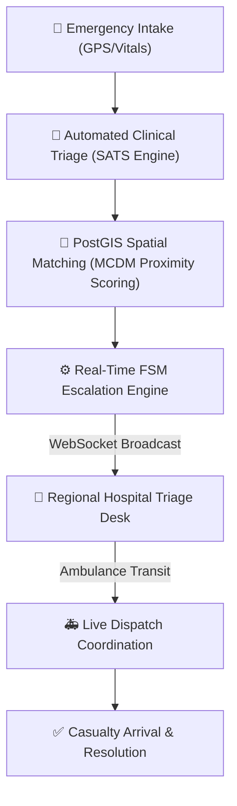

# 🏥 MedLink

**Intelligent Computer-Aided Dispatch (CAD) & Regional Healthcare Coordination Platform**

[](LICENSE)
[](https://nodejs.org/)
[](https://postgis.net/)
[](https://react.dev/)
[](https://vitejs.dev/)
[](https://socket.io/)

MedLink is an enterprise-grade Computer-Aided Dispatch (CAD) and regional healthcare coordination platform designed for emergency casualty triage, geospatial hospital ranking using PostGIS, real-time WebSocket hospital telemetry, and resilient offline-first casualty intake.

---

## 📌 Architecture & Core Capabilities



### Key Modules
- **Automated Clinical Triage (SATS)**: Multi-parameter vital assessment (SpO2, heart rate, systolic blood pressure, AVPU consciousness level) with automated clinical acuity classification.
- **PostGIS Geospatial Matching**: Microsecond-latency spatial queries (`ST_SetSRID(ST_MakePoint(...), 4326)`) combined with Multi-Criteria Decision Making (MCDM) weighing distance, ICU bed saturation, doctor availability, and blood bank stock.
- **Finite State Machine (FSM) Escalation Engine**: Automated escalation pipeline (`reported` ➔ `assessing` ➔ `requested` ➔ `assigned` ➔ `en_route` ➔ `arrived` ➔ `resolved`) with timeout fallbacks to secondary regional facilities.
- **Real-Time Telemetry & WebSockets**: Dedicated Socket.IO streaming rooms for instantaneous dispatch alerts, status synchronization, and hospital inventory tracking.
- **Role-Based Access Control (RBAC)**: Enforces strict isolation across CAD Dispatchers, Hospital Facility Managers, and Citizen Portals.
- **Offline-First Resilience**: Local storage outbox queuing with bi-directional delta synchronization (`/api/sync/delta`) when network connectivity is restored.

---

## 📂 Project Structure

```
├── backend/                  # Express REST API & Socket.IO real-time engine
│   ├── db/                   # Database schemas & spatial indexes
│   ├── scripts/              # Database initialization, migration & seed scripts
│   ├── src/
│   │   ├── config/           # Database pool configuration
│   │   ├── middleware/       # JWT authentication & RBAC authorization
│   │   ├── routes/           # REST endpoints (auth, incidents, hospitals, analytics, sync)
│   │   ├── services/         # Clinical triage, PostGIS matcher, FSM coordinator
│   │   └── server.js         # HTTP & WebSocket entrypoint
│   └── package.json
│
├── frontend/                 # React 19 + Vite CAD Web Application
│   ├── src/
│   │   ├── components/       # Glassmorphism dispatch dashboards, explorers & intake forms
│   │   ├── context/          # Authentication & session context
│   │   ├── utils/            # Offline outbox & local storage caching
│   │   ├── api.js            # Centralized REST API client
│   │   └── socket.js         # Socket.IO client
│   └── package.json
│
└── README.md
```

---

## 🚀 Quick Start

### Prerequisites
- **Node.js** (v18.0.0 or higher)
- **PostgreSQL 14+** with the **PostGIS extension** enabled
- **npm** or **yarn**

### 1. Backend Setup

```bash
cd backend
npm install
cp .env.example .env
# Configure your PostgreSQL credentials in .env
```

**Initialize Database:**
```bash
npm run db:setup
```

**Start Backend Server:**
```bash
npm run dev
# Server running at http://localhost:4000 (WebSocket on ws://localhost:4000)
```

### 2. Frontend Setup

```bash
cd frontend
npm install
npm run dev
# Application available at http://localhost:5173
```

---

## 📄 License
This project is licensed under the MIT License - see the [LICENSE](LICENSE) file for details.
Commit at 2026-08-30T04:07:33.612946
Commit at 2025-11-04T06:56:56.850678
Commit at 2025-11-19T14:28:16.022499
Commit at 2026-03-03T23:17:30.202415
Commit at 2025-11-11T03:01:55.377026
Commit at 2025-12-02T21:18:33.558406
Commit at 2026-08-28T22:11:47.746479
Commit at 2026-02-07T09:44:59.939501
Commit at 2026-09-11T22:46:11.170907
Commit at 2025-12-16T04:16:03.393217
Commit at 2026-08-27T09:45:09.621851
Commit at 2026-09-02T02:41:15.857298
Commit at 2026-04-21T13:32:31.064540
Commit at 2026-07-24T02:06:13.291776
Commit at 2026-10-13T09:51:53.530484
Commit at 2026-10-28T13:32:29.761755
Commit at 2026-06-14T09:19:08.977005
Commit at 2025-11-23T03:50:38.226453
Commit at 2026-09-15T20:02:11.444107
Commit at 2025-12-27T09:23:56.664581
Commit at 2026-01-22T19:19:52.893712
Commit at 2026-05-06T08:57:51.105927
Commit at 2026-01-21T16:50:02.473603
Commit at 2025-11-22T19:48:41.958674
Commit at 2026-07-01T01:22:19.309359
Commit at 2025-12-22T12:35:29.574468
Commit at 2026-01-18T03:55:24.826790
Commit at 2026-09-05T09:48:39.155382
Commit at 2026-02-18T11:13:04.484722
Commit at 2026-08-28T18:17:53.795966
Commit at 2026-05-27T17:26:52.141224
Commit at 2026-10-17T11:21:10.445272
Commit at 2026-10-13T10:25:37.821855
Commit at 2026-04-20T00:14:30.719764
Commit at 2026-10-02T16:06:01.019756
Commit at 2025-11-18T16:06:17.369955
Commit at 2025-11-02T04:14:31.710439
Commit at 2026-10-23T04:43:08.136564
Commit at 2026-10-05T13:32:19.503526
Commit at 2026-08-28T12:24:12.844104
Commit at 2025-11-29T21:26:19.223722
Commit at 2025-11-27T23:42:47.734374
Commit at 2025-12-20T23:51:42.037974
Commit at 2026-03-04T08:11:50.417155
Commit at 2026-02-11T08:04:32.809455
Commit at 2026-02-07T11:57:27.251302
Commit at 2026-06-11T07:28:27.537221
Commit at 2026-06-14T23:02:15.009550
Commit at 2026-07-13T06:41:42.437916
Commit at 2025-12-26T05:07:16.753252
Commit at 2025-12-27T19:47:32.021437
Commit at 2026-08-19T20:42:40.290277
Commit at 2026-09-13T23:54:08.539890
Commit at 2025-11-27T00:58:18.890716
Commit at 2026-02-21T16:54:51.217867
Commit at 2025-12-01T19:10:41.455244
Commit at 2026-03-14T10:49:17.813186
Commit at 2025-11-04T15:17:00.229281
Commit at 2026-03-03T06:02:21.680908
Commit at 2026-04-28T10:43:30.108090
Commit at 2026-03-13T18:44:06.631811
Commit at 2026-06-19T07:53:56.032007
Commit at 2026-05-12T22:42:21.497311
Commit at 2026-07-16T02:37:06.012684
Commit at 2025-12-22T04:35:53.488529
Commit at 2026-05-01T11:25:56.852307
Commit at 2025-12-27T22:36:13.372490
Commit at 2026-09-25T08:02:23.848954
Commit at 2026-01-31T06:28:03.152011
Commit at 2026-04-17T18:09:48.419969
Commit at 2026-10-09T22:48:39.681821
Commit at 2026-09-14T12:42:21.935370
Commit at 2026-01-13T11:50:28.202107
Commit at 2026-03-20T05:12:22.464246
Commit at 2026-10-19T01:35:43.721914
Commit at 2026-08-08T05:21:02.029206
Commit at 2026-05-17T17:31:10.279313
Commit at 2026-04-07T19:54:11.545364
Commit at 2025-11-09T10:02:07.066075
Commit at 2026-06-18T13:35:57.400430
Commit at 2026-01-08T20:21:32.687755
Commit at 2026-10-14T01:39:43.938179
Commit at 2026-06-22T14:55:17.218682
Commit at 2026-06-10T17:09:19.486610
Commit at 2026-05-04T13:02:00.730644
Commit at 2026-06-24T12:17:55.001132
Commit at 2026-09-09T21:40:03.253532
Commit at 2026-05-24T13:24:36.494211
Commit at 2026-03-18T17:39:08.739560
Commit at 2025-12-03T06:09:18.009640
Commit at 2026-08-26T01:22:58.330935
Commit at 2026-06-19T18:21:58.669348
Commit at 2026-10-01T20:08:16.955712
Commit at 2025-11-06T21:58:14.196871
Commit at 2025-12-18T15:28:08.485003
Commit at 2026-10-08T18:42:00.723945
Commit at 2026-01-04T10:29:36.966379
Commit at 2026-09-27T16:47:49.243214
Commit at 2026-03-06T02:50:16.607757
Commit at 2026-01-12T23:20:31.901842
Commit at 2026-07-05T16:03:11.228558
Commit at 2026-02-26T01:41:45.669254
Commit at 2026-05-30T23:14:16.469079
Commit at 2026-05-13T17:47:45.945955
Commit at 2025-12-10T01:50:38.262641
Commit at 2026-04-11T01:13:09.600037
Commit at 2025-11-17T08:20:34.980037
Commit at 2026-09-14T03:10:50.330897
Commit at 2026-08-06T02:32:05.645434
Commit at 2026-08-28T13:08:57.017582
Commit at 2026-07-04T21:53:03.315046
Commit at 2026-01-22T01:23:17.613630
Commit at 2026-09-02T08:10:59.079218
Commit at 2026-08-12T05:15:03.449331
Commit at 2026-01-08T19:40:06.778548
Commit at 2026-08-21T16:06:19.047862
Commit at 2026-10-02T13:06:36.548143
Commit at 2025-12-23T19:47:56.912873
Commit at 2026-06-03T00:47:23.328316
Commit at 2026-03-30T02:13:30.647478
Commit at 2026-10-03T18:42:37.881290
Commit at 2026-10-15T21:49:28.098858
Commit at 2026-04-27T23:45:00.307790
Commit at 2026-04-09T15:12:48.549413
Commit at 2026-02-19T09:36:37.788979
Commit at 2026-06-28T14:03:06.776768
Commit at 2026-06-04T04:52:09.201203
Commit at 2026-08-22T14:34:03.533575
Commit at 2026-10-06T23:18:22.813129
Commit at 2026-10-26T18:30:45.156300
Commit at 2026-05-01T00:36:48.389018
Commit at 2025-12-24T17:14:05.629527
Commit at 2026-09-26T15:51:01.839966
Commit at 2026-08-01T14:21:53.067336
Commit at 2026-09-05T19:04:32.360559
Commit at 2026-01-06T06:08:31.628998
Commit at 2025-12-05T23:42:43.862385
Commit at 2026-04-04T00:12:59.210797
Commit at 2025-10-30T10:10:42.491633
Commit at 2026-08-21T18:10:09.812101
Commit at 2025-12-27T21:07:26.060944
Commit at 2026-05-13T15:43:13.315539
Commit at 2026-10-22T13:21:11.609516
Commit at 2025-12-28T12:01:54.879245
Commit at 2026-09-21T11:19:38.186845
Commit at 2026-01-11T10:57:58.521032
Commit at 2026-01-08T13:49:35.926450
Commit at 2026-04-29T12:26:46.381436
Commit at 2026-06-30T23:42:24.761347
Commit at 2026-02-13T04:30:51.204765
